# Desk Thing

A CarPlay-style desk controller for **YouTube Music**, built for an old Android phone (made on a Pixel 4 XL) running in kiosk mode. It controls **Pear Desktop** (formerly YouTube Music Desktop) on your PC and shows an **American Truck Simulator** map from **TruckNav** with spoken turn-by-turn directions. It also has a voice assistant you talk to through your PC microphone: "Hey Jarvis".

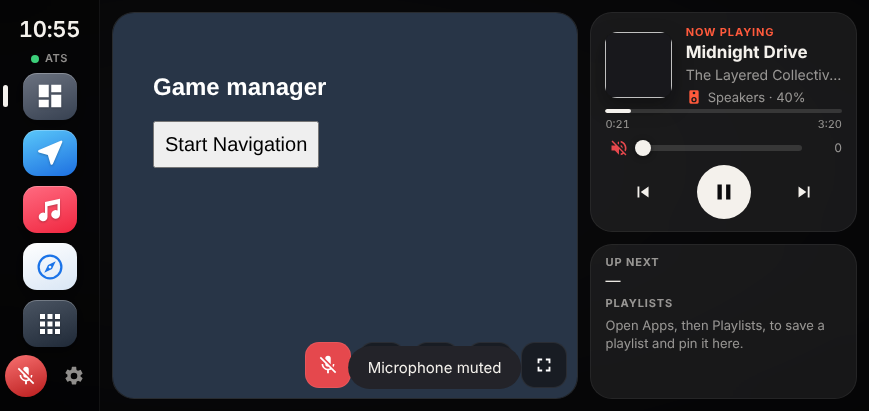

## Features

- **Dashboard**: ATS map, now playing, up next and pinned playlists side by side
- **Music**: full-screen player, volume, like, queue, playlists, and a music mute button
- **ATS map**: TruckNav's map with optional voice directions ("In 0.6 miles, turn left")
- **Browser**: a built-in browser with bookmarks
- **Jarvis assistant**: say "Hey Jarvis" (or tap the mic) to:
  - control music: "skip", "pause", "volume 40", "mute", "what's playing"
  - play anything: "play Tennessee Whiskey"
  - set a TruckNav destination: "navigate to Denver", "take me to Springfield Illinois", "cancel route"
  - get the weather: "what's the weather", "is it going to rain tomorrow"
  - ask anything else, answered by your own local AI with **Ollama** (optional, see [OLLAMA.md](OLLAMA.md))
- **Microphone mute** button so the PC stops listening completely
- **Apps screen**, themes, clock screen, and the current Windows audio output shown on the player

## Screenshots

*Shown at the Pixel 4 XL's screen size with demo music and a demo map.*

| | |
| --- | --- |
| 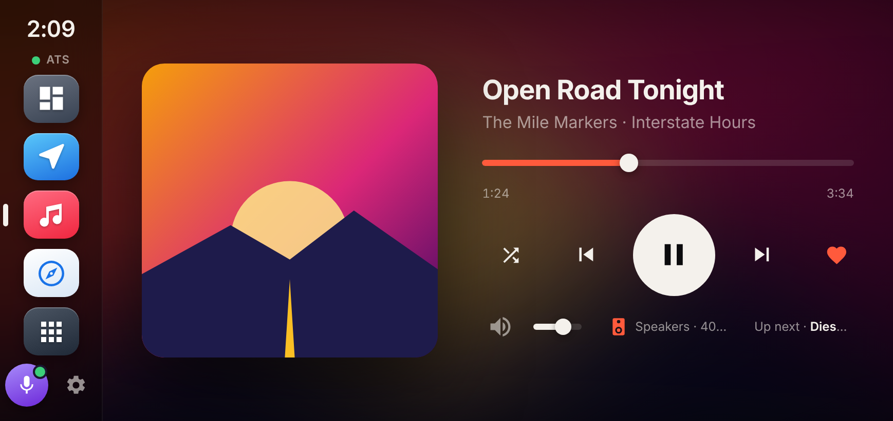 **Now playing** | 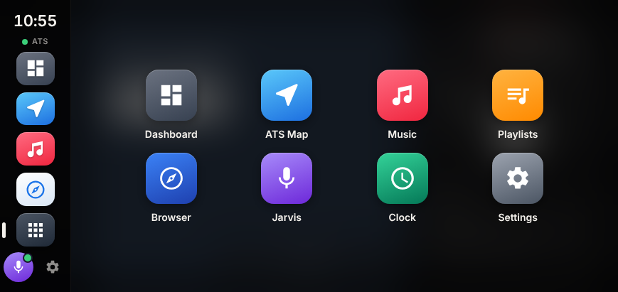 **Apps screen** |
| 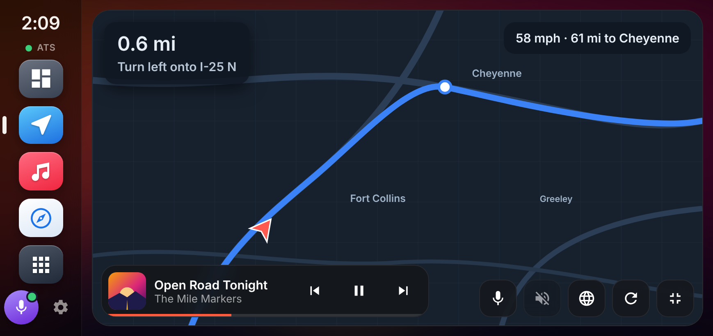 **Full-screen ATS map** | 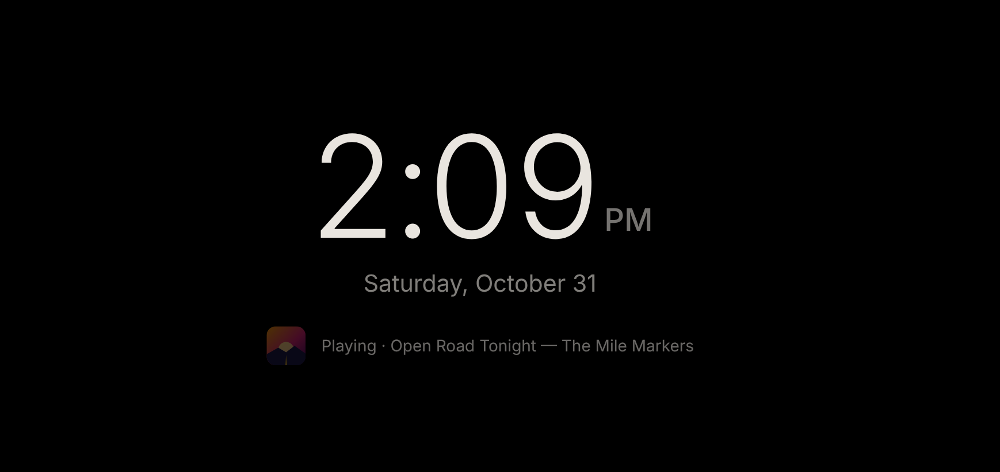 **Clock screen** |
| 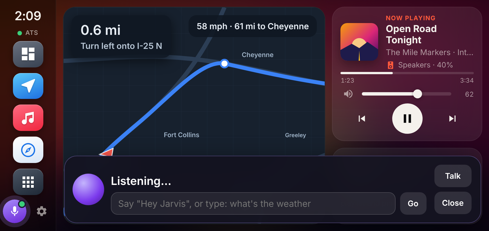 **"Hey Jarvis"** | 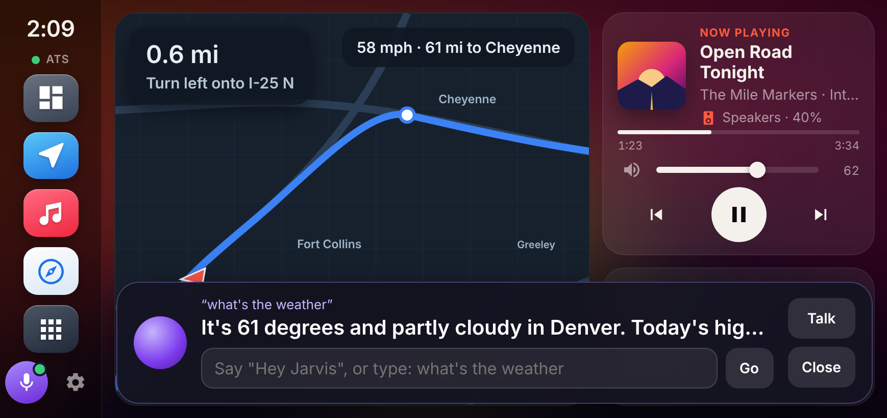 **"What's the weather"** |
| 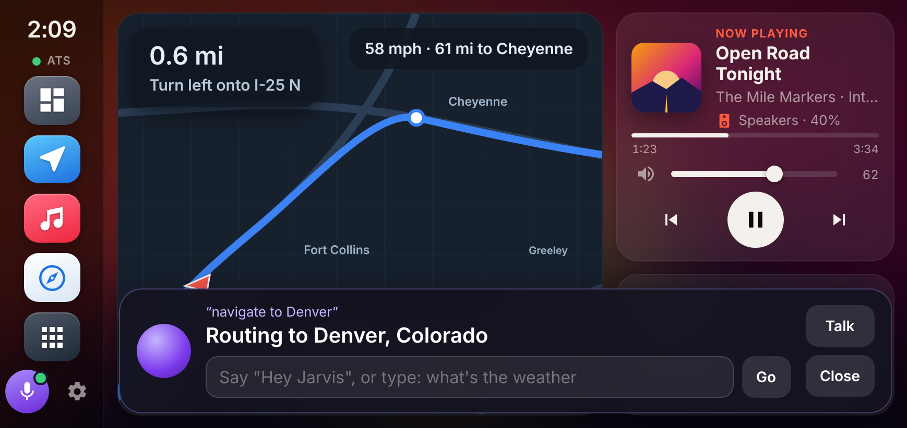 **"Navigate to Denver"** | 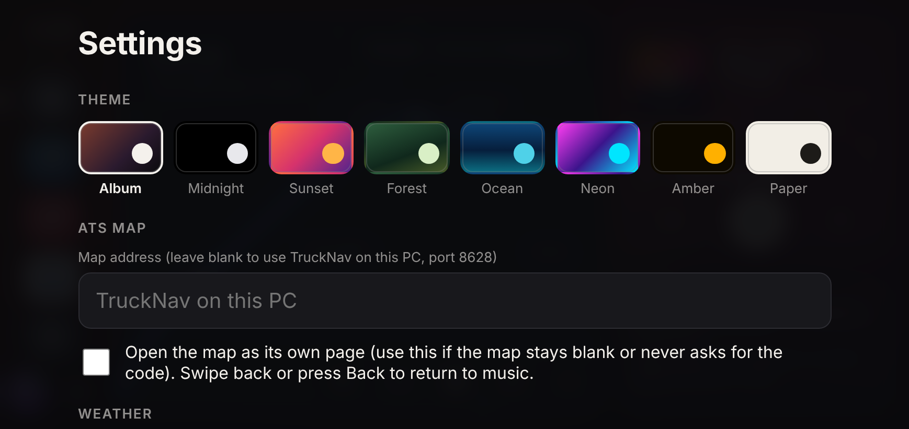 **Settings and themes** |
| 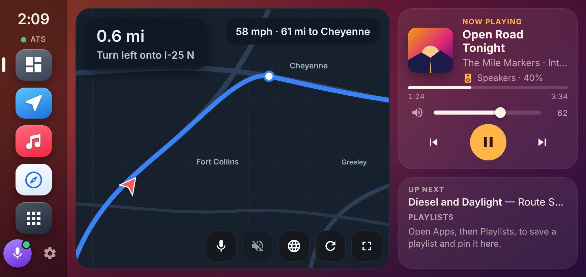 **Sunset theme** | 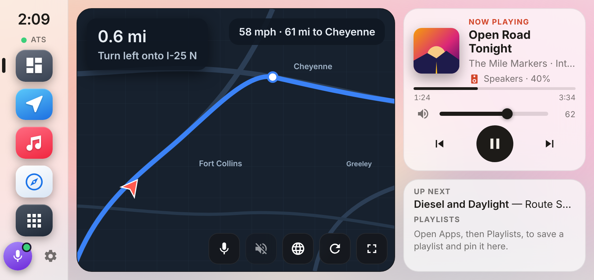 **Paper theme** |
| 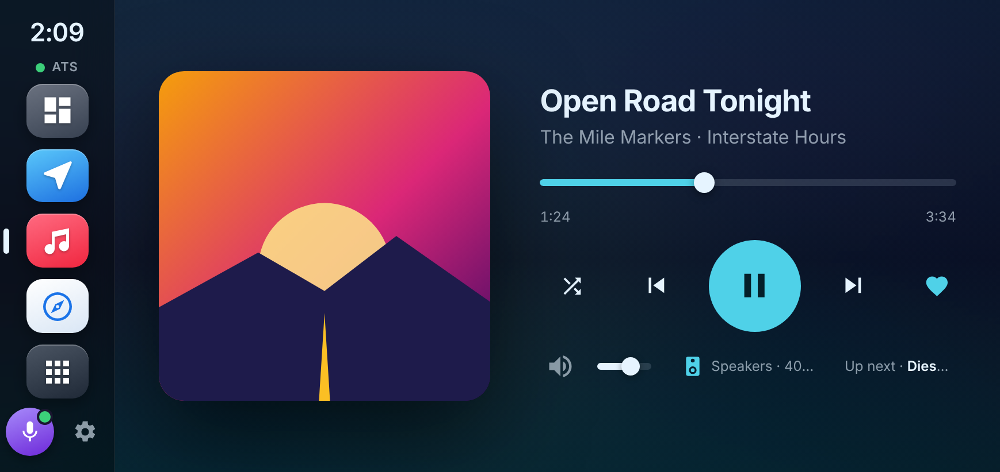 **Ocean theme** | 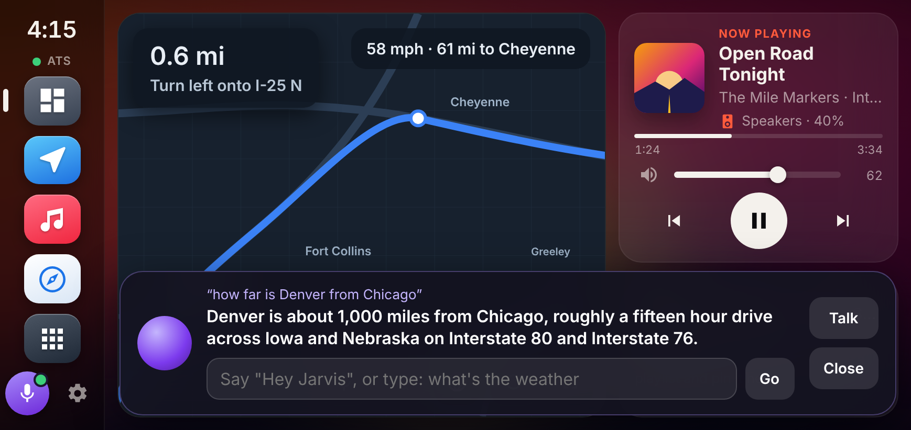 **Asking Ollama** |

## What you need

- A Windows PC running **Pear Desktop** with the **API Server** plugin turned on
- An Android phone or tablet with **Fully Kiosk Browser** (the free version works)
- [Android platform-tools](https://developer.android.com/tools/releases/platform-tools) (adb) with USB debugging turned on for the phone
- Optional: **TruckNav** for the ATS map, voice directions and destinations
- Optional: [NaturalVoiceSAPIAdapter](https://github.com/gexgd0419/NaturalVoiceSAPIAdapter) for natural-sounding Windows voices

## Install

1. Download this repository (**Code → Download ZIP**) and put all of its files in your **platform-tools** folder, next to `adb.exe`.
2. Connect the phone with USB debugging on.
3. If you use TruckNav, open it once so its map folder exists.
4. Double-click **`install-assistant.bat`**. It:
   - copies the voice page (`navvoice.html`) into TruckNav's maps folder
   - starts the PC helper (`audio-output-server.ps1`) for audio output, voice and the microphone
   - pushes the Desk Thing to the phone and restarts Fully Kiosk
5. In Fully Kiosk, set the start URL to `file:///sdcard/Android/data/de.ozerov.fully/files/pear-deskthing.html`.
6. On the Desk Thing, open **Settings**, enter your PC's IP address and press **Connect**. Approve the pop-up in Pear Desktop. Enter your city under **Weather**.

If Windows Firewall asks about PowerShell, allow it on private networks. The phone talks to the PC helper on port **26540**.

## Files

| File | What it does |
| --- | --- |
| `pear-deskthing.html` | The Desk Thing itself (runs on the phone) |
| `navvoice.html` | TruckNav voice page: spoken directions and setting destinations |
| `audio-output-server.ps1` | PC helper: audio output info, text-to-speech, speech recognition and the wake word |
| `start-audio-output.bat` / `stop-audio-helper.ps1` | Start or stop the PC helper |
| `audio-output-test.bat` | Checks that the helper can read your audio output |
| `voice-sample.bat` | Lists your Windows voices and plays a sample of the one being used |
| `push-deskthing.bat` | Sends `pear-deskthing.html` to the phone |
| `install-assistant.bat` | Does all of the above in one go |

## Optional: Ollama

To let Jarvis answer general questions with a local AI model on your network, follow **[OLLAMA.md](OLLAMA.md)**.

## Choosing the voice

The helper uses the best natural US English voice it finds (Ava, Jenny, Aria, Emma), otherwise Zira. To pick a specific one, create `voice.txt` next to the scripts and type part of the voice's name in it (for example `Andrew`), then run `install-assistant.bat` again.

## Privacy

Speech recognition and the voice both run on your PC using Windows' built-in speech features. Nothing is recorded or sent anywhere. Weather comes from [Open-Meteo](https://open-meteo.com/) (no account or key).

## License

MIT. See [LICENSE](LICENSE).
